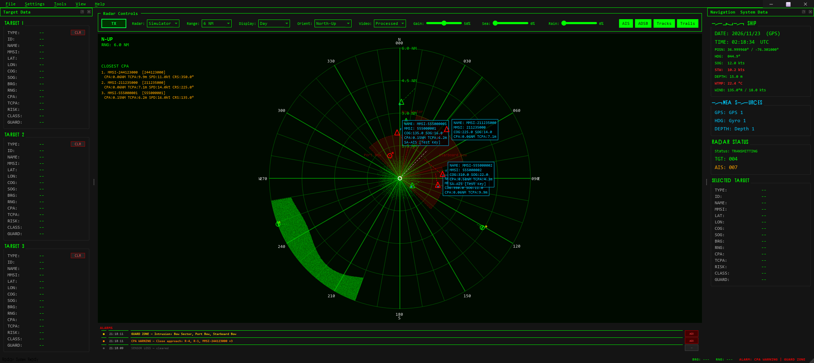

# Marine Radar GUI Application

Professional ARPA-compliant radar display and control application for maritime radar systems. Follows IMO Resolution A.823(19), IEC 62388, and SN.1/Circ.243/Rev.2 display conventions.



*Day mode, North-Up, 6 NM range, running the built-in radar simulator with `test_nmea_sender.py` supplying GPS, heading, depth and AIS (including encrypted SA-AIS) data.*

## Features

### Display Modes (IMO Compliant)
- **Day** — High contrast, bright colors for daylight operation
- **Dusk** — Medium contrast for twilight conditions
- **Night** — Low intensity green phosphor style
- **Red Night** — Red-only for dark adaptation preservation

### Orientation Modes
- **North-Up** — North always at top (default)
- **Head-Up** — Own ship heading at top
- **Course-Up** — Own ship course at top
- **True Motion** — Own ship moves, chart stationary; auto-resets at 75% of range

### Target Tracking (ARPA / AIS / ADS-B)

#### ARPA Radar Targets
- Displayed as **green circles**
- Orange caution and red dangerous at CPA/TCPA threshold crossings
- 500 ms blink for critical and warning targets

#### AIS Targets
- **Unencrypted AIS** — green triangles (standard surface traffic)
- **Encrypted SA-AIS** — blue triangles, **automatically classified FRIENDLY** when decrypted with a configured AES key. An operator classification set from the right-click menu (friendly / neutral / hostile) always takes precedence; **Clear Classification** returns the target to the automatic friendly classification
- **Dangerous / hostile** — red flashing triangles regardless of encryption status
- AIS Base Stations (Type 4) — teal hollow squares; not forwarded to track manager
- **Lost targets** — an AIS target with no position report for **6 minutes** is removed (it is never frozen at its last position)
- **Unavailable SOG/COG** — shown as `---`; no speed vector is drawn and no CPA/TCPA is computed (never treated as 0 kn / due north)
- A target appears only after its first **position** report; static data (name, call sign) received first is held and merged in

#### ADS-B Aircraft Targets
- Displayed as **cyan directional triangles** rotated to face the aircraft's track
- Alarm level coloring: cyan (normal) → yellow (caution) → red flashing (urgent)
- ICAO hex address label above symbol; relative altitude (±m) below
- Speed vector indicating track and ground speed
- 15-second stale-target pruning
- Sentences with a bad NMEA checksum are rejected; aircraft are only plotted once own-ship position is known (they are never placed at 0°N 0°E)

#### Tracking Features
- **CPA/TCPA** calculations for all surface targets, using own ship's **course over ground** (from RMC/VTG) when moving faster than 0.5 kn, otherwise heading
- **Negative TCPA** — a target whose CPA has already passed shows "passed N min ago" and is left out of the Closest CPA list
- **Threat assessment** — safe / caution / warning / critical risk tiers
- **Bow crossing range** — distance ahead (+) or astern (−) at which a target crosses own ship's course line
- **Click-to-select** — click any target for the full detail panel
- **Kalman filtering** for smooth radar track positions, using the actual time between updates (skipped for targets the radar has already tracked)
- **Hide stationary / moored AIS** — operator toggle to suppress anchored and moored vessels (speed < 0.5 kts); threats and selected targets always remain visible
- **Anchor Watch** — Monitor own-ship position against a fixed anchor point with configurable swing radius. If GPS goes offline the dialog shows **NO GPS — NOT MONITORING** and an active drag alarm is kept, never cleared on a stale position

### Priority-Tiered Track Correlation
Radar/AIS correlation uses a spatial grid index and proximity-based priority scheduling:
- **Spatial grid index** — AIS targets bucketed into 0.3 NM cells; radar tracks search only their 3×3 cell neighbourhood (O(n×m) → O(n×k))
- **CRITICAL tier (< 1.5 NM)** — correlated every update cycle
- **NEAR tier (1.5–3 NM)** — correlated every 2nd cycle (~5 Hz)
- **FAR tier (> 3 NM)** — correlated every 5th cycle (~2 Hz); previous result carried forward on skipped cycles

### Navigation Data (NMEA-0183)
- **Multi-source UDP input** with priority-based failover
- Rate-agnostic parser — handles mixed rates (e.g. 10 Hz position, 2 Hz depth, 1 Hz time)
- AIS target ingestion (AIVDM / AIVDO) with full ITU-R M.1371 decoding
- **NMEA data staleness indicators** — labels in the Own Ship panel turn **red** when a sensor has not sent data for more than 10 seconds, giving the operator immediate visibility of any offline instrument
- **NMEA Monitor** (Tools > NMEA Monitor) — live raw sentence viewer with source selector, Play/Stop, scroll, and Clear

#### Supported NMEA-0183 Sentences

| Sentence | Description | Typical Rate |
|----------|-------------|--------------|
| **GGA** | GPS Fix — latitude, longitude, quality, satellites | 1–10 Hz |
| **GLL** | Geographic Position — latitude, longitude | 1–10 Hz |
| **RMC** | Recommended Minimum — position, SOG, COG, UTC time/date | 1 Hz |
| **VTG** | Course Over Ground and Ground Speed | 1–10 Hz |
| **HDT** | True Heading | 1–10 Hz |
| **HDG** | Heading with magnetic deviation/variation (auto-corrected to true) | 1–10 Hz |
| **DBT** | Depth Below Transducer (feet, meters, fathoms) | 1–2 Hz |
| **DPT** | Depth of Water | 1–2 Hz |
| **ZDA** | UTC Time & Date (year, month, day, timezone) | 1 Hz |
| **ROT** | Rate of Turn (deg/min) | 1–2 Hz |
| **VHW** | Water Speed and Heading through water (STW) | 1–2 Hz |
| **MWV** | Wind Speed and Angle (relative or true, auto-converts units) | 1 Hz |
| **MTW** | Water Temperature (Celsius, auto-converts from Fahrenheit) | 0.1–1 Hz |
| **RSA** | Rudder Sensor Angle (logged) | 1 Hz |
| **XTE** | Cross Track Error (logged) | 1 Hz |
| **GSA** | GPS DOP and Active Satellites (accepted, no action) | 1 Hz |
| **GSV** | Satellites in View (accepted, no action) | 1 Hz |
| **AIVDM** | AIS VHF Data-link Message (Class A/B targets) | varies |
| **AIVDO** | AIS Own-vessel Report | varies |

All talker IDs accepted (GP, GN, GL, GA, HE, HC, SD, WI, YX, AG, etc.). Checksum verification performed on all sentences.

#### AIS Message Types Decoded

| Type | Description |
|------|-------------|
| **1, 2, 3** | Class A Position Report (MMSI, SOG, COG, heading, lat/lon, nav status) |
| **4** | Base Station Report (MMSI, lat/lon) — teal hollow squares; not forwarded to track manager |
| **5** | Class A Static/Voyage Data (name, call sign, ship type, destination) |
| **18** | Class B Position Report |
| **24** | Class B Static Data (parts A and B) |

### ADS-B / FLARM Aircraft Tracking
Receives FLARM-standard NMEA sentences over UDP from any compatible ADS-B receiver (Stratux, dump1090, OpenSky feeder, or FLARM device):

| Sentence | Description |
|----------|-------------|
| **$PFLAA** | Traffic position record — relative N/E/vertical offset, ICAO ID, track, speed, alarm level, aircraft type |
| **$PFLAU** | Receiver status — GPS fix, receive count, alarm level |

**Position conversion:** `$PFLAA` positions are receiver-relative (metres). The application converts to absolute lat/lon using own ship's GPS: `tgt_lat = own_lat + RelN / 111320`. Own ship GPS must be active.

**Aircraft type codes:** Unknown (0), Glider (1), Tow (2), Helicopter (3), Parachute (4), Drop plane (5), Hang-glider (6), Paraglider (7), Piston (8), Jet (9), Balloon (11), Airship (12), UAV (13), Static obstacle (15).

Configure sources via **Settings > NMEA Sources > ADS-B Sources** tab. Default UDP port: **10117**.

### Encrypted AIS (SA-AIS)
- AES-128-CBC and AES-256-CBC decryption of Secure AIS payloads
- Uses the `cryptography` library backed by OpenSSL 3.x (FIPS 140-3 capable)
- Key management dialog (Settings > Encrypted AIS Keys)
- Keys entered in HEX or ASCII with live bidirectional conversion
- Auto-detection of cipher from key length (32 hex = AES-128, 64 hex = AES-256)
- Decrypted SA-AIS targets displayed as **blue triangles** with an "F" tag and **automatically classified friendly** (operator classification overrides)
- Keys persisted to `ais_encrypt_config.json` (plain hex — restrict file access to authorised users)
- **Security note:** AES-CBC has no integrity check, so successful decryption does not prove who sent a message. Anyone without the key can still alter a captured encrypted message's content in a controlled way, and random data occasionally (about 1 in 600) decrypts to a valid-looking message. Such a message would then be shown as a friendly target. Verify friendly contacts by other means before relying on them. If the encrypted-AIS scheme can be changed, prefer an authenticated mode (AES-GCM, or AES-CBC + HMAC)

### PTZ Camera Control
Slew a Pan/Tilt/Zoom camera to any AIS or ARPA target via NMEA-style UDP commands:

- **Bearing Mode:** True °T (for cameras with a built-in gyro/compass) or Relative to ship heading °R (for cameras without a gyro)
- **Configurable NMEA template:** `$[HDR],[BRG]*[CHK]` with custom message header, standard XOR checksum
- **Camera response parser:** configurable response header and field index for the returned azimuth value
- **PPI line of bearing:** camera's current azimuth displayed as a bright cyan line extending 12 NM from own ship
- **"Slew Camera to Target"** in the right-click context menu for any AIS or ARPA contact
- Configure via **Settings > NMEA Sources > Camera Control** tab

### Radar Standby / Transmit Control
A prominent **STBY / TX** toggle at the left end of the Radar Controls bar lets the operator command the radar between standby and transmit states:

- **STBY** (amber) — radar powered but not transmitting
- **TX** (bright green) — radar actively transmitting
- The button updates only when the radar hardware confirms the state change via `transmit_state_changed` signal, so it accurately reflects actual hardware state rather than operator intent
- Connects to `RadarInterface.set_transmit(bool)` — see [Radar SDK Integration](#radar-sdk-integration)
- Radar video and the sweep line appear only while transmitting. The picture is cleared on standby, disconnect or radar change

### Own Ship Data Panel
- **DATE / TIME** — UTC date and local time derived from NMEA ZDA; **double-click the time** to set the timezone offset (21 presets from UTC−12 to UTC+12, or custom entry)
- **POSN** — Latitude / Longitude (from GGA, RMC, GLL)
- **HDG** — True heading (from HDT, HDG, VHW)
- **SOG** — Speed Over Ground in knots (from RMC, VTG)
- **STW** — Speed Through Water in knots (from VHW)
- **DEPTH** — Depth below transducer (from DBT, DPT)
- **WTMP** — Water temperature in Celsius (from MTW)
- **WIND** — Wind angle and speed with R (relative) / T (true) indicator (from MWV)

Stale or offline labels are highlighted **red** for immediate fault visibility.

### Data Readout Area (PPI Overlay)
Fixed-position display in the top-left of the PPI showing:
- Orientation mode (N-UP, H-UP, C-UP, TM)
- Range scale (e.g. RNG: 12.0 NM) and ring interval (RI: 3.00 NM)
- Cursor bearing, range, latitude, and longitude
- **Closest CPA summary** — Top 3 tracks sorted by CPA distance with name, track ID, CPA, TCPA, speed, and course, color-coded by risk level

### EBL / VRM (Electronic Bearing Line / Variable Range Marker)
- **EBL1 / EBL2** — Dashed bearing lines from center, draggable to any angle
- **VRM1 / VRM2** — Dashed range circles, draggable to any radius
- Toggle via View > EBL/VRM menu or keyboard shortcuts
- Live bearing/range readout in status bar

### Audible Alarms
- **CPA Critical** — Rapid high-frequency beep for collision-imminent targets
- **CPA Warning** — Medium beep for close-approach targets
- **Guard Zone Intrusion** — Double beep when a target enters a guard zone (clears when the target leaves or its track is lost)
- **GPS Spoofing** — Alternating warble when spoofing is detected
- **Sensor Loss** — Low-frequency slow beep when the GPS or heading source goes offline. Depth is optional: it alarms only if depth data has been received and then stops
- **Radar Link** — Warble when the radar connection is lost (immediately after a working link drops; after 15 s if a radar never connects)
- **No Radar Video** — Tone when the radar is transmitting but no video has arrived for 5 s
- **Anchor Drag** — Slow double-beep when own ship drifts outside the configured swing radius
- Each alarm type is evaluated independently (rules in `core/alarm_rules.py`). A critical CPA alarm clears as soon as no target is critical, even if another target is still at warning
- Per-alarm acknowledge buttons with flash animation — **each press of S (or clicking ACK) acknowledges exactly one alarm**; subsequent alarms require separate acknowledgment to ensure operators are alerted to every condition
- New alarms that arrive after all existing ones are acknowledged will sound and flash until explicitly acknowledged — the S key never pre-silences future alarms
- Alarm history panel with timestamps
- Audio via in-memory WAV synthesis through the default sound card
- Global silence / un-silence via View menu or **F12** — automatically re-enables after **5 minutes** with a countdown shown in the status bar; ensures a silenced console cannot miss a new threat indefinitely
- All alarm events (triggered, acknowledged, silenced, cleared) are appended to **`logs/alarm_log.txt`** with timestamps for post-incident review and compliance records
- The full application log is written to **`logs/radar_gui.log`** (rotating, 5 × 5 MB)

### Right-Click Context Menu
- Target Info dialog with full detail
- Acquire/Track and Cancel Track (radar targets)
- Mark as Friendly / Neutral / Hostile with visual classification tags
- Set per-target CPA/TCPA alert thresholds
- Add to Guard Zone
- Calculate Intercept course/speed/time (COLREGS Rule 8 note)
- Set as Reference Target
- **Slew Camera to Target** — sends PTZ slew command (greyed out if camera control is disabled)

### Help Menu
**Help > PPI Symbols & Keyboard Shortcuts...** opens a reference dialog showing:
- Symbol legend: ARPA circle, unencrypted AIS triangle, encrypted SA-AIS triangle, ADS-B triangle, base station square, own ship, heading line, EBL, VRM, guard zone, camera bearing line
- Full keyboard shortcut reference table

### System Messages
- Accessible via **View > Panels > System Messages...** — opens a non-modal popup with the full timestamped log
- Non-modal popup allows continued radar operation while reviewing messages

---

## Installation

### Prerequisites

**Windows 11:**
```bash
python --version    # 3.9 or later required
```

**Red Hat Enterprise Linux:**
```bash
sudo dnf install python3 python3-pip python3-devel gcc-c++
```

### Install Application

```bash
git clone https://github.com/<your-org>/radar-gui.git
cd radar-gui

# Windows
python -m pip install -r requirements.txt

# Linux
python3 -m pip install -r requirements.txt
```

### Dependencies

| Package | Version | Purpose |
|---------|---------|---------|
| PyQt6 | ≥ 6.4, < 7 | GUI framework |
| numpy | ≥ 1.24, < 3 | Numerical processing |
| cryptography | ≥ 42, < 47 (optional) | AES decryption for Secure AIS (OpenSSL 3.x backend) |

The application **does not install packages itself**. If a required package is missing it prints the `pip install -r requirements.txt` command and exits.

---

## Running the Application

### With Simulated Radar (Testing)

```bash
# Windows
python main.py

# Linux
python3 main.py
```

The default radar entry uses the `mock` (simulator) driver. The radar starts in **STBY**; press **STBY/TX** to start transmitting and show video. To use a Furuno radar, see [Furuno SDK DLLs](#furuno-sdk-dlls--what-is-required).

### Running the Tests

```bash
python -m unittest discover -s tests -v
```

### Sending Test NMEA Data

In a second terminal:
```bash
python test_nmea_sender.py
```

Sends simulated multi-rate NMEA data:
- **10 Hz** — GGA, VTG, HDT (position, speed over ground, heading)
- **2 Hz** — DBT, ROT, VHW (depth, rate of turn, speed through water)
- **1 Hz** — RMC, ZDA, MWV, GLL (recommended minimum, time/date, wind, position)
- **0.2 Hz** — MTW (water temperature)
- **0.33 Hz** — AIVDM position reports (5 normal AIS + 2 encrypted SA-AIS targets)
- **Startup** — AIS static/voyage data (vessel names, ship types, call signs)

### Testing ADS-B Input

Send a test $PFLAA sentence to UDP port 10117 using any UDP sender:
```
$PFLAA,0,1000,500,180,1,ABCDEF,045,,52,0,8*<checksum>
```
A cyan directional triangle should appear approximately 1 km NNE of own ship.

---

## Configuration

### NMEA Sources
**Settings > NMEA Sources** — Configure multiple UDP input sources for GPS, Heading, Depth, AIS, and ADS-B data with priority-based failover.

Default UDP ports:

| Source | Default Port |
|--------|-------------|
| GPS | 10110 |
| Heading / Gyro | 10111 |
| Depth | 10112 |
| AIS | 10113 |
| ADS-B / FLARM | 10117 |
| Camera Command (send) | 10120 |
| Camera Response (listen) | 10121 |

### PTZ Camera
**Settings > NMEA Sources > Camera Control** tab:
- Enable camera control
- Camera host IP, send port (command), listen port (response)
- **Bearing Mode:** Relative °R (no gyro) or True °T (gyro-stabilised)
- NMEA message template (`$[HDR],[BRG]*[CHK]`) with live preview
- Response header and azimuth field index
- Manual slew test

### Encrypted AIS Keys
**Settings > Encrypted AIS Keys** — Add, edit, or remove AES keys. Keys persisted to `ais_encrypt_config.json`.

### CPA/TCPA Thresholds
**Settings > CPA/TCPA Thresholds**:
- **Threat detection gate** — outer boundary (default: 2.0 NM / 12 min)
- **Critical** — triggers fast audible alarm (default: 0.5 NM / 6 min)
- **Warning** — triggers audible alarm (default: 1.0 NM / 12 min)
- **Caution** — visual color change only (default: 2.0 NM / 20 min)

---

## Controls

### Window Management (Frameless Mode)
The main window runs without an OS title bar for a clean full-screen radar presentation:

| Action | How |
|--------|-----|
| **Move window** | Click and drag on any empty area of the menu bar (between menu labels and the ─ ⬜ ✕ buttons) |
| **Maximize / Restore** | Double-click the empty menu bar area, or click **⬜** |
| **Minimize** | Click **─** in the top-right corner of the menu bar |
| **Close** | Click **✕** (turns red on hover) or use **Ctrl+Q** |
| **Resize** | Drag the grip in the bottom-right corner of the status bar; or use Windows snap (Win+Arrow) |

### Top Control Bar

| Control | Options / Range | Description |
|---------|-----------------|-------------|
| **STBY / TX** | Toggle | Radar standby / transmit command |
| **Radar** | Configured units | Active radar selection; switching restarts the driver without blocking |
| **Range** | From the connected radar | Range list comes from the radar's capabilities (e.g. DRS4D-NXT: up to 36 NM) |
| **Display** | Day / Dusk / Night / Red Night | IMO display mode |
| **Orient** | N-Up / H-Up / C-Up / True Motion | Orientation mode |
| **Video** | Processed / Raw | Radar video mode |
| **Gain** | 0 – 100% | Receiver gain |
| **Sea** | 0 – 100% | Sea clutter (STC) rejection |
| **Rain** | 0 – 100% | Rain clutter (FTC) rejection |
| **AIS** | Toggle | Show / hide AIS surface targets |
| **ADSB** | Toggle | Show / hide ADS-B aircraft targets |
| **Tracks** | Toggle | Show / hide ARPA tracks |
| **Trails** | Toggle | Show / hide past-position trails |

### Keyboard Shortcuts

| Key | Action |
|-----|--------|
| **+** / **=** | Increase display range |
| **−** | Decrease display range |
| **Z** | Range in (zoom in one step) |
| **X** | Range out (zoom out one step) |
| **S** | Acknowledge next unacknowledged alarm (one at a time, in display order) |
| **D** | Cycle display mode (Day › Dusk › Night › Red Night) |
| **O** | Cycle orientation (N-Up › H-Up › C-Up › True Motion) |
| **A** | Toggle AIS targets |
| **B** | Toggle ADS-B targets |
| **T** | Toggle ARPA tracks |
| **L** | Toggle past-position trails |
| **G** | Toggle guard zones |
| **R** | Toggle range rings |
| **F1** | Toggle EBL1 |
| **F2** | Toggle EBL2 |
| **F3** | Toggle VRM1 |
| **F4** | Toggle VRM2 |
| **F12** | Silence / un-silence all alarms (auto-re-enables after 5 minutes) |
| **Ctrl+Q** | Exit application |

### Settings Menu
- **Radar** — Radar units: driver (`mock` / `furuno`), model, IP/port, SDK DLL path
- **NMEA Sources** — Multi-source UDP input (GPS, Heading, Depth, AIS, ADS-B, Camera Control)
- **Guard Zones** — Guard zone boundary configuration. Each zone is **Relative (bow)** — it turns with the ship — or **True (north)**. The default Bow / Port Bow / Starboard Bow zones are bow-relative
- **Encrypted AIS Keys** — AES key management for SA-AIS decryption
- **CPA/TCPA Thresholds** — Threat detection gate and risk-tier boundaries

### Tools Menu
- **Built-In Test (BIT)** — Radar subsystem fault status panel with 1 Hz auto-polling and a fault log. Hardware indicators (transmitter, motor, temperature, receiver, power supply) require a real radar SDK. The following **software self-tests run immediately without any hardware**:
  - **CONFIG FILES** — verifies `config/nmea_config.json` and `config/ais_encrypt_config.json` are present and contain valid JSON
  - **ALARM LOG** — verifies the `logs/` directory and alarm log file are writable
  - **GPS INPUT / HEADING INPUT** — live NMEA parser source status (green = source active)
  - **GPS SPOOFING** — live spoofing detector state
  - **Run Full Test** — executes all checks and prints per-item PASS/FAIL detail to the fault log
  - **Test Alarm Audio** — plays a tone through the default audio device immediately, bypassing any silenced or acknowledged alarm state; use to verify audio output before a voyage
- **NMEA Monitor** — Live raw NMEA-0183 sentence viewer with source selector, Play/Stop, scroll, and Clear

### View Menu
- Show AIS Targets
- **Show Moored / Stationary AIS** — Hide anchored/moored vessels (speed < 0.5 kts); threats always shown
- **Show AIS Base Stations** — Teal hollow squares for AIS Type 4 shore-based transmitters
- **Show ADS-B Targets** — Toggle ADS-B aircraft display
- **Anchor Watch...** — Own-ship swing-radius position monitoring
- Show Tracks / Show Guard Zones
- Range Rings (show/hide, count, reset)
- Trail Length (1 / 3 / 6 / 15 / 30 min)
- EBL/VRM (EBL1, EBL2, VRM1, VRM2)
- **Panels** submenu — floating popup windows for secondary data:
  - **AIS Targets...** — Live list of first 10 AIS vessels (name, MMSI, COG, SOG); updates automatically while open
  - **System Messages...** — Full timestamped system event log
- Silence Alarms (F12 global toggle)

### Help Menu
- **PPI Symbols & Keyboard Shortcuts...** — Symbol legend and keyboard reference

### Right Panel (Navigation & System Data)
- **OWN SHIP** — Date/time (double-click to set timezone), Position, HDG, SOG, STW, DEPTH, WTMP, WIND; stale labels shown in red
- **NMEA SOURCES** — Active GPS, heading, depth sources
- **RADAR STATUS** — Operating status, target and AIS counts
- **SELECTED TARGET** — Full detail for the clicked target
- **ALARMS** — Active and recent alarms with per-alarm ACK buttons

> AIS Targets and System Messages are available as floating popups via **View > Panels** to keep the main display uncluttered.

---

## Anchor Watch

**View > Anchor Watch...** monitors own-ship position against a fixed anchor point.

1. Click **Refresh Targets** — combo boxes populate with stationary radar tracks (speed < 1.0 kts)
2. Optionally select 1–3 stationary reference targets (landmarks, buoys, fixed structures)
3. Set **Swing Radius** (0.01–2.00 NM, default 0.10 NM ≈ 185 m)
4. Click **Activate Watch** — own-ship GPS position is recorded; 1 Hz monitoring begins
5. A dashed **gold circle** appears on the PPI centred on the anchor with an anchor cross symbol

**While active:**
- Drift label colour: green (< 50% radius), amber (50–100%), red (dragging)
- **Anchor Drag** audible alarm fires (slow double-beep, 1000 Hz) when drift exceeds the swing radius

Click **Deactivate** or close the dialog to stop monitoring.

---

## Known Limitations

The following features are present in the codebase but are stubs, placeholders, or limited by the mock radar interface:

### Radar Hardware (Primary Limitation)
With the default `mock` driver, all radar video and ARPA targets are **simulated**: four moving vessels, sea clutter and a coastline. Gain, sea clutter and video mode change the simulated picture. The **Furuno** driver is complete, but its DLL bindings use placeholder names and structure layouts until they are matched to the licensed Furuno Sensor SDK header (see [Furuno SDK DLLs](#furuno-sdk-dlls--what-is-required)).

### Built-In Test (BIT) Window
Hardware indicators (transmitter, motor, temperature, receiver, power supply, signal processor, display) come from the active radar driver's `get_status()`. The simulator always reports OK. A RADAR LINK indicator shows whether the driver is connected, and **Run Full Test** logs model, firmware, hours and temperature when the SDK provides them. Five software self-tests (config file integrity, alarm log writability, GPS source, heading source, GPS spoofing) are fully functional without any hardware and update at 1 Hz.

### Plugin System (`core/plugin_system.py`)
Three example plugin classes are included as development scaffolding but contain no real implementation:
- **RecordingPlugin** — File handles open and close correctly, but no radar data is ever written to disk (`pass` in the write loop)
- **TargetClassificationPlugin** — ML classification hook; returns data unchanged
- **WeatherOverlayPlugin** — Weather data merge hook; no data source connected

Plugins are not exposed through the application UI.

### Test Scenarios (`core/test_scenarios.py`)
Reference CPA/TCPA scenarios (crossing, head-on, overtaking, parallel passing, multiple targets) with hand-checked expected values. They run as part of the unit tests (`tests/test_safety_fixes.py`) but have no UI entry point.

### Unused Modules
`core/radar_logger.py`, `core/performance_monitor.py`, `core/system_watchdog.py`, `core/radar_performance.py` and `core/plugin_system.py` are not used by the application. They are kept for possible future use.

### Satellite Quality Sentences
GSA (GPS DOP / fix mode) and GSV (satellites in view) sentences are received and verified but their content is discarded. Satellite count and dilution-of-precision data are not currently displayed or used for position confidence assessment.

---

## Radar SDK Integration

Radar hardware is connected through **drivers**. Each driver converts one vendor SDK's types and callbacks into the application's own data types. The GUI never calls an SDK directly. Two drivers are included:

| Driver | `"driver"` value | Status |
|--------|------------------|--------|
| Simulator | `mock` | Works out of the box (default) |
| Furuno Sensor SDK | `furuno` | Complete driver; the DLL bindings must be matched to the licensed SDK header (see below) |

### Driver Architecture

```
radar_config.json entry ──► core/radar/factory.py  create_radar(cfg)
                                       │
                 ┌─────────────────────┴─────────────────────┐
         core/radar/mock.py                     core/radar/furuno/driver.py
           (simulator)                            │  worker thread: ALL SDK calls
                                                  │  SDK callbacks → Spoke / RadarTarget
                                                  ▼
                                         core/radar/furuno/bindings.py   (ctypes only)
                                                  ▼
                                           Furuno SDK DLL(s)
                 └─────────────────────┬─────────────────────┘
                        RadarInterface signals (GUI thread)
            spokes_received ─► gui/radar_video.py ─► PPI video image
            targets_updated ─► main_window (bearing/range → lat/lon) ─► TrackManager
            status_changed / connection_changed / error_occurred ─► status panel, BIT
```

| File | Purpose |
|------|---------|
| `core/radar/types.py` | `Spoke`, `RadarTarget`, `RadarStatus`, `RadarCapabilities`, all independent of any vendor SDK |
| `core/radar/base.py` | `RadarInterface` abstract driver, threading rules, thread-safe spoke batching |
| `core/radar/factory.py` | Driver registry: `create_radar(cfg)`, `register_driver(name, cls)` |
| `core/radar/mock.py` | Simulator. It produces spokes and stable-ID ARPA targets exactly as a real driver would |
| `core/radar/furuno/models.py` | Furuno models and their default capabilities |
| `core/radar/furuno/bindings.py` | **ctypes boundary.** The only file that has to match the SDK header |
| `core/radar/furuno/driver.py` | `FurunoRadar` driver: worker thread, command queue, callbacks, status polling |
| `gui/radar_video.py` | Spoke buffer and polar-to-screen PPI image renderer (numpy) |
| `tests/fake_sdk/fake_furuno_sdk.c` | Stand-in DLL implementing the placeholder API, so the driver can be tested without hardware |

### Selecting a Radar

Radars are listed in `radar_config.json` (edit it in **Settings > Radar**). The **Radar** dropdown on the main window switches between them while the application is running. The old driver is stopped and the new one is started without blocking the GUI.

```json
{
  "radars": [
    { "name": "Simulator", "driver": "mock", "ip": "127.0.0.1", "port": 10001, "enabled": true },
    {
      "name": "Bridge X-Band",
      "driver": "furuno",
      "model": "DRS4D-NXT",
      "ip": "192.168.1.100",
      "port": 10001,
      "dll_path": "C:/Radar_gui/radar_sdk/furuno/bin/x64/FurunoSensorSDK.dll",
      "dll_dirs": ["C:/Radar_gui/radar_sdk/furuno/bin/x64/deps"],
      "calling_convention": "cdecl",
      "bearing_is_true": false,
      "symbol_map": { "set_range": "FSDK_SetRangeIndex" },
      "enabled": true
    }
  ]
}
```

| Key | Required | Meaning |
|-----|----------|---------|
| `driver` | yes | `mock` or `furuno` (or any driver you register) |
| `model` | Furuno | One of `DRS2D-NXT`, `DRS4D-NXT`, `DRS6A-NXT`, `DRS12A-NXT`, `DRS25A-NXT`, `DRS4DL+`, `FAR3230`. Sets the range list and capabilities |
| `ip`, `port` | yes | Radar / SDK network address, taken from the Furuno SDK documentation |
| `dll_path` | Furuno | Full path to the main SDK DLL |
| `dll_dirs` | no | Extra folders holding DLLs the SDK DLL depends on. The DLL's own folder is always searched |
| `calling_convention` | no | `cdecl` (default) or `stdcall`. Use `stdcall` if the header declares functions `__stdcall`, `WINAPI` or `CALLBACK` |
| `bearing_is_true` | no | `true` if the SDK reports ARPA target bearings relative to north rather than the bow |
| `symbol_map` | no | Renames DLL functions without editing code (`logical name → DLL export name`) |

> The file name `FurunoSensorSDK.dll` above is an example only. Use the actual file names shipped in your SDK.

---

### Furuno SDK DLLs — What Is Required

The Furuno Sensor SDK is **licensed**, and its API is not published. This project therefore ships a complete driver whose DLL boundary (`bindings.py`) is written against **placeholder** names and structure layouts. The steps below take you from receiving the SDK to a working radar.

#### 1. Obtain the SDK

- Contact Furuno: **SDK@Furuno.com**, +1 360-834-9300, or www.FurunoUSA.com/SDK.
- You must accept the *Furuno Sensor SDK License Agreement*. There is an SDK fee and an annual support fee.
- Supported sensors listed by Furuno: DRS2D-NXT, DRS4D-NXT, DRS6A-NXT, DRS12A-NXT, DRS25A-NXT, DRS4DL+ (discontinued), and the commercial FAR3230 S-band.
- Ask Furuno for: the **Windows x64** DLL build, the C header (`.h`), the API reference manual, and the sample code. Also ask whether the SDK needs a license key or file at runtime.

#### 2. Make sure the DLL matches your Python

A 64-bit Python can only load a 64-bit DLL, and a 32-bit Python only a 32-bit DLL.

```bash
# Python bitness (expect 64)
python -c "import struct; print(struct.calcsize('P') * 8)"

# DLL bitness — from a "Developer Command Prompt for VS"
dumpbin /headers FurunoSensorSDK.dll | findstr machine
#   8664 machine (x64)  → 64-bit      14C machine (x86) → 32-bit
```

Also install the **Microsoft Visual C++ Redistributable** version the SDK was built with (named in the SDK documentation). A missing redistributable is the most common cause of `OSError: [WinError 126] The specified module could not be found`.

#### 3. Put the DLL files in place

Recommended layout inside the project folder. `radar_sdk/` is listed in `.gitignore`, so licensed files are never committed:

```
Radar_gui/
└── radar_sdk/
    └── furuno/
        ├── include/            # SDK header(s) — reference for step 5
        ├── bin/x64/
        │   ├── <main SDK>.dll  # → "dll_path"
        │   └── <dependency>.dll ...   (same folder, or list folders in "dll_dirs")
        ├── license/            # runtime license file, if the SDK uses one
        └── docs/
```

Rules:
- Keep **every** DLL the SDK needs in the same folder as the main DLL, or list their folders in `dll_dirs`. Python 3.8 and later **do not** search `PATH` for a DLL's dependencies. The driver calls `os.add_dll_directory()` for these folders before it loads the DLL.
- Do not copy SDK DLLs into `C:\Windows\System32` or the Python folder.
- If the SDK has an installer that puts the DLLs under `C:\Program Files\...`, point `dll_path` there instead of copying them.

#### 4. Configure the radar

In **Settings > Radar**, click **Add Radar**. Set Driver = `furuno`, pick the Model, enter the IP and port, and browse to the DLL. Then select the radar in the main-window **Radar** dropdown. The status panel shows `CONNECTING`, then `STANDBY` once connected, or `ERROR` with the reason in System Messages.

#### 5. Match `bindings.py` to the SDK header

Open `core/radar/furuno/bindings.py` next to the SDK header. Everything marked `PLACEHOLDER` or `VERIFY` must be checked:

| Item in `bindings.py` | What to check in the SDK header / manual |
|---|---|
| `FUNCTION_TABLE` symbol names | Exported function names (`dumpbin /exports <dll>` lists them). Rename here, or use `symbol_map` in the config |
| `FUNCTION_TABLE` argtypes / restype | Exact C parameter and return types (`int`, `float`, `double`, pointers, handles). Many SDKs return a *handle* from init/connect that must be passed to every later call. If so, add a `c_void_p` handle parameter and store it in the driver |
| Return-code convention | `FurunoSDK.check()` assumes `0` means success. Change it if the SDK uses a different convention (e.g. `1` = OK, negative = error) |
| `FurunoEchoData` | Spoke struct: angle field and **angles per revolution**, range units (metres vs. NM vs. range index), sample count, sample bit depth (the GUI expects 8-bit 0–255; scale 4-bit or 16-bit samples in `driver._on_echo`), and whether data is inline or a pointer. Add `_pack_ = 1` if the header uses `#pragma pack(1)` |
| `FurunoTargetData`, `TARGET_STATES` | ARPA target fields, ID type, whether bearing is true or relative (set `bearing_is_true`), state codes |
| `FurunoStatusData`, `FAULT_BITS` | Status fields and alarm/fault bit positions → BIT window indicators |
| `make_callback_types()` | Callback signatures. If they are `CALLBACK`/`__stdcall`, set `"calling_convention": "stdcall"` |
| `set_range` (driver `_range_to_sdk`) | Whether the SDK takes a range **index**, metres or NM |
| Gain / sea / rain | Value range (set `gain_range` in `models.py`) and how auto mode is selected |
| `models.py` | Replace the `VERIFY` defaults (spokes per revolution, samples per spoke, ARPA limit) with SDK values, or query them from the SDK at connect time |

Things the driver already handles that must stay as they are:
- **Callback references are stored** in `self._callbacks`. If a ctypes callback object is garbage-collected while the DLL still holds it, Python crashes without any error message.
- **Echo buffers are copied** (`.copy()`) before the callback returns, because the SDK reuses its buffer.
- **Callbacks are unregistered before disconnect/shutdown** in `_close_sdk()`.
- **All SDK functions are called from one worker thread.** Do not call SDK functions from GUI methods; use `self._enqueue(...)` instead.

#### 6. Test before connecting real hardware

A fake SDK DLL implementing the placeholder API is included. It exercises loading, callbacks, threading, transmit confirmation and shutdown:

```bat
:: x64 Native Tools Command Prompt for VS
cd tests\fake_sdk
cl /LD /O2 fake_furuno_sdk.c /Fe:fake_furuno_sdk.dll
cd ..\..
set FURUNO_FAKE_DLL=%CD%\tests\fake_sdk\fake_furuno_sdk.dll
python -m unittest discover -s tests -v
```

When you change `bindings.py` to match the real header, update `fake_furuno_sdk.c` the same way. The fake then stays a hardware-free regression test. To run the same test against the **real** SDK and a live radar, point `FURUNO_FAKE_DLL` at the real DLL and set `FURUNO_RADAR_IP`.

#### 7. Network setup

- Give the PC's radar network adapter a static IP on the radar's subnet (per the Furuno SDK documentation).
- Allow `python.exe` through **Windows Defender Firewall** for UDP and TCP on that adapter. Radar video is usually UDP, often multicast, and is silently dropped if blocked.
- Use a wired Ethernet adapter dedicated to the radar where possible. Video bandwidth is significant.

#### Furuno driver troubleshooting

| Message (System Messages / status bar) | Cause | Fix |
|---|---|---|
| `No 'dll_path' configured` | Config entry has no DLL path | Set it in Settings > Radar |
| `Furuno SDK DLL not found: …` | Wrong path | Check `dll_path` |
| `Could not load …  Python is 64-bit …` | Bitness mismatch, missing dependent DLL, or missing VC++ Redistributable | Steps 2 and 3 |
| `required functions are missing: …` | Placeholder symbol names don't match the DLL | Step 5: `FUNCTION_TABLE` or `symbol_map` |
| `connect to … failed (code N)` | Radar unreachable or wrong IP/port, firewall, or no license | Step 7. Check the SDK's error code table |
| Connected but no video after TX | Echo callback signature/struct mismatch, or firewall blocking UDP | Step 5 (`FurunoEchoData`) and step 7 |
| Video rotated or mirrored | Relative vs. true angle, or angle resolution wrong | `true_bearing` / `angle_resolution` in `_on_echo` |
| Application exits with no error | ctypes struct or signature mismatch (memory corruption) | Re-check every field type and order against the header |

---

### Adding Another Radar Brand

1. Create `core/radar/<vendor>/bindings.py` (ctypes only) and `driver.py` with a class subclassing `RadarInterface`.
2. Implement the abstract methods. Follow the threading rules in `core/radar/base.py`: `start()` must not block; push spokes with `self._queue_spoke()` from any thread; emit other signals directly.
3. Register it in `_BUILTIN_DRIVERS` in `core/radar/factory.py` (or call `register_driver('vendor', 'module:Class')`).
4. Add its models to `MODELS_BY_DRIVER` in `gui/radar_config_dialog.py`.
5. Run `tests/test_radar_drivers.py`. The mock tests show the behaviour every driver must have.

### RadarInterface Reference

| Method | Required | Description |
|--------|----------|-------------|
| `start()` / `stop()` | yes | Connect without blocking; stop must unregister callbacks first and be safe to call twice |
| `get_capabilities()` | yes | `RadarCapabilities`: ranges, spokes/rev, samples, which controls exist |
| `get_status()` | yes | `RadarStatus`: link, TX state, faults, hours, temperature, firmware (used by BIT) |
| `set_transmit(bool)` | yes | Emit `transmit_state_changed` only when the radar **confirms** the change |
| `set_range(nm)`, `set_gain(%)`, `set_sea_clutter(%)`, `set_rain_clutter(%)` | yes | Core controls |
| `set_video_mode`, `set_auto_gain/sea/rain`, `set_interference_rejection`, `set_target_expansion`, `set_control` | optional | Extra controls |
| `set_own_ship(lat, lon, hdg, sog, cog)` | optional | Navigation feed. Called on every GPS/heading update |
| `acquire_target(true_brg, range_m)`, `cancel_target(id)`, `cancel_all_targets()` | optional | ARPA. Wired to the right-click **Acquire / Cancel Track** menu |

| Signal | Payload | Description |
|--------|---------|-------------|
| `connection_changed` | `bool` | Link to radar up/down |
| `transmit_state_changed` | `bool` | Hardware-confirmed TX/STBY. The STBY/TX button follows this |
| `spokes_received` | `list[Spoke]` | Batched video (~30 Hz) |
| `targets_updated` | `list[RadarTarget]` | ARPA targets with stable IDs, bearing/range from own ship |
| `status_changed` | `RadarStatus` | Health update |
| `capabilities_changed` | `RadarCapabilities` | Sent on connect. The GUI rebuilds the range list and video resolution from it |
| `error_occurred` | `str` | Human-readable error for the status bar and log |

---

## Application Architecture

```
radar_gui/
├── main.py                          # Entry point; reports missing dependencies (never auto-installs)
├── requirements.txt                 # PyQt6, numpy, cryptography
├── test_nmea_sender.py              # Simulated NMEA + AIS data generator
├── README.md
├── QUICKSTART.md
├── gui/
│   ├── main_window.py               # Main window, menus, controls, shortcuts, alarm wiring
│   ├── ppi_display.py               # PPI display — sweep, ARPA, AIS, ADS-B, camera line, EBL/VRM
│   ├── radar_video.py               # Spoke buffer → PPI video image (numpy polar-to-screen)
│   ├── color_themes.py              # IMO color themes (Day / Dusk / Night / Red Night)
│   ├── target_panel.py              # Selected target detail panel (CPA, TCPA, risk)
│   ├── alarm_widget.py              # Alarm history strip with per-alarm ACK buttons
│   ├── nmea_config_dialog.py        # NMEA source configuration (all source types + camera)
│   ├── radar_config_dialog.py       # Radar units: driver, model, IP/port, SDK DLL path
│   ├── guard_zone_dialog.py         # Guard zone configuration (bow-relative or true zones)
│   ├── formatting.py                # Display formatting for unavailable values ('---')
│   ├── ais_encrypt_dialog.py        # Encrypted AIS key management (AES-128/256-CBC)
│   ├── cpa_settings_dialog.py       # CPA/TCPA threshold configuration dialog
│   ├── bit_window.py                # Built-In Test diagnostic window
│   ├── nmea_monitor_dialog.py       # Live NMEA-0183 sentence monitor (Tools menu)
│   └── anchor_watch_dialog.py       # Anchor Watch — swing-radius position monitoring
├── core/
│   ├── logger.py                    # Centralized logging configuration
│   ├── alarm_manager.py             # Audible alarm controller (6 alarm types, WAV synthesis)
│   ├── ais_decrypt.py               # AES-CBC decryption engine for Secure AIS (SA-AIS)
│   ├── multi_source_nmea_parser.py  # Multi-source NMEA-0183 parser + AIS decoder
│   ├── track_manager.py             # Track correlation, CPA/TCPA, classification, trails
│   ├── radar/                       # Radar driver layer (SDK integration point)
│   │   ├── types.py                 # Spoke, RadarTarget, RadarStatus, RadarCapabilities
│   │   ├── base.py                  # RadarInterface abstract driver + threading rules
│   │   ├── factory.py               # create_radar(cfg) driver registry
│   │   ├── mock.py                  # Simulator driver
│   │   └── furuno/                  # Furuno Sensor SDK driver
│   │       ├── models.py            # DRS-NXT / FAR model capabilities
│   │       ├── bindings.py          # ctypes DLL bindings (match to SDK header)
│   │       └── driver.py            # FurunoRadar driver
│   ├── radar_interface.py           # Backward-compatibility shim → core/radar
│   ├── camera_controller.py         # PTZ camera — NMEA slew commands + azimuth response
│   ├── adsb_receiver.py             # ADS-B / FLARM NMEA receiver ($PFLAA / $PFLAU)
│   ├── cpa_calculator.py            # CPA/TCPA calculations, intercept calculator
│   ├── track_filter.py              # Kalman and Alpha-Beta track filters
│   ├── guard_zone.py                # Guard zone definitions and intrusion detection
│   ├── alarm_rules.py               # Which alarms are active (pure, unit-tested rules)
│   ├── gps_spoofing_detector.py     # GPS spoofing detection (time jumps, speed, position)
│   ├── plugin_system.py             # Plugin architecture for extensibility
│   ├── performance_monitor.py       # System performance metrics (FPS, CPU, memory, data rates)
│   ├── radar_logger.py              # Radar / NMEA / system event logger for replay/diagnostics
│   ├── radar_performance.py         # Radar RF performance analyser (SNR, interference)
│   ├── system_watchdog.py           # System component health monitor with alarm integration
│   └── test_scenarios.py            # Automated CPA/TCPA test scenarios
├── tests/
│   ├── test_radar_drivers.py        # Driver contract, video buffer, track association tests
│   ├── test_furuno_fake_sdk.py      # Furuno ctypes driver end-to-end test (needs fake/real DLL)
│   ├── test_safety_fixes.py         # GPS fix loss, AIS expiry, CPA, alarms, guard zones, Kalman, HDG
│   └── fake_sdk/fake_furuno_sdk.c   # Stand-in SDK DLL source implementing the placeholder API
└── radar_sdk/                       # (You create; git-ignored) licensed vendor SDK files
    └── furuno/
        ├── include/                 # SDK header(s)
        └── bin/x64/                 # SDK DLL + dependent DLLs → "dll_path"
```

---

## Troubleshooting

### Application won't start
```bash
python --version    # Must be 3.9+
pip install --force-reinstall -r requirements.txt
```

### Radar status shows ERROR / DRIVER ERROR
Read the message in System Messages or the status bar. For the Furuno driver, see the [Furuno driver troubleshooting](#furuno-driver-troubleshooting) table. Select **Simulator** in the Radar dropdown to go back to simulated data.

### No NMEA data updating
- Verify the NMEA source is sending UDP to the configured port (default GPS: 10110)
- Check firewall settings — UDP ports must be open
- Test with `python test_nmea_sender.py`
- Check **Settings > NMEA Sources** configuration

### Own Ship panel labels are red
A red label means no data has been received from that sensor for more than 10 seconds. Check the corresponding NMEA source and network connection.

### ADS-B targets not appearing
- Confirm the ADS-B receiver is outputting $PFLAA sentences to the configured UDP port (default 10117)
- Own ship GPS must be active — ADS-B positions are relative and require own ship lat/lon to convert
- Check **Settings > NMEA Sources > ADS-B Sources** tab

### No alarm sounds
- Ensure the default audio output device is configured in Windows Sound settings
- Alarms use WAV synthesis through the default sound card (not the legacy PC speaker)
- Check **View > Silence Alarms** is not checked

### Camera bearing line not visible
- Enable camera control in **Settings > NMEA Sources > Camera Control**
- Confirm the camera is returning $PFLAA-style response sentences on the listen port
- Check bearing mode (True vs Relative) matches your camera hardware

### Display issues
- Update graphics drivers
- Try a different display mode (Day vs Night)

---

## Version History

**v5.2** — Encrypted (SA-AIS) targets are again **automatically classified friendly**; an operator classification still overrides it. Second review pass: ADS-B rejects bad NMEA checksums, no longer plots aircraft at 0°N 0°E before own position is known, and uses a monotonic clock for staleness. Camera responses are checksum-verified and the azimuth is validated (finite, 0–360°). Anchor Watch no longer reports "WATCHING", or clears a drag alarm, while GPS is offline.

**v5.1** — Safety and correctness fixes from code review:
- **Navigation input.** A GPS that loses its fix no longer moves own ship to 0°N 0°E (GGA fix quality checked, empty positions rejected). HDG applies deviation and variation, falls back to the RMC variation, and warns once if a magnetic heading can't be corrected. Lowercase NMEA checksums are accepted.
- **AIS.** Targets expire 6 minutes after their last position report (they previously stayed forever at their last position). Unavailable SOG/COG shows as `---` with no CPA (previously treated as 0 kn / due north). Static data no longer creates phantom targets at 0°N 0°E. Multi-sentence messages with a missing fragment are discarded. Updates are published at 1 Hz instead of once per message.
- **CPA.** Receding targets report negative TCPA. CPA uses course over ground. Bow crossing range is calculated correctly. A single CPA calculator is shared, so threshold changes apply everywhere.
- **Alarms.** Alarm rules moved to `core/alarm_rules.py` and each type is evaluated independently, which fixes a critical CPA alarm that never cleared. Guard-zone alarms clear when a track is lost, and events are logged once. New Radar Link and No Radar Video alarms. Depth loss alarms only after depth has worked. Active alarms are never dropped from history.
- **Guard zones.** Bow-relative or true, set per zone.
- **Display and tracking.** Kalman filter uses the real time between updates. True Motion draws EBL/VRM, guard zones and the cursor readout from own ship. Timeouts use a monotonic clock.
- **Security and maintenance.** Encrypted AIS auto-friendly classification removed (restored in v5.2). No automatic `pip install` at start-up; dependency versions pinned. Rotating application log. A failed config read no longer wipes the NMEA config when camera settings are saved. CPA reference scenarios fixed and included in the test suite.

**v5.0** — Radar SDK driver layer. New `core/radar/` package: SDK-independent data types (`Spoke`, `RadarTarget`, `RadarStatus`, `RadarCapabilities`), a non-blocking `RadarInterface` with thread-safe spoke batching, and a driver factory selected per radar by the `"driver"` field in `radar_config.json`. **Furuno Sensor SDK driver** (DRS2D/4D/6A/12A/25A-NXT, DRS4DL+, FAR3230) with ctypes bindings, a single SDK worker thread, callback lifetime handling and status polling, plus a fake SDK DLL for hardware-free testing. PPI video rewritten to render radar spokes through a numpy polar-to-screen image (about 3 ms per frame), with the sweep line following the real antenna angle. Simulator now produces spokes with sea clutter, a coastline and stable-ID ARPA targets. This fixes radar tracks being duplicated on every update. Radar-filtered ARPA targets skip the Kalman filter, radar tracks time out after 60 s, and Acquire/Cancel Track are wired to the radar. The Radar dialog gains Driver, Model and DLL Path columns; the range list adapts to the connected radar; the BIT window shows RADAR LINK and hardware details.

**v4.2** — Frameless window and BIT / alarm hardening: OS title bar removed; window controls (─ ⬜ ✕) integrated into the right side of the menu bar; drag-to-move from the empty menu bar area; double-click to maximize/restore; resize grip in status bar corner. BIT window made partially functional without radar hardware — CONFIG FILES and ALARM LOG self-tests poll at 1 Hz, Run Full Test prints per-check PASS/FAIL detail, Test Alarm Audio button plays a tone immediately bypassing any silenced alarm state. F12 global silence now auto-re-enables after **5 minutes** with a status bar countdown. All alarm events (triggered, acknowledged, silenced, cleared) appended to `logs/alarm_log.txt` for post-incident review.

**v4.1** — UI readability and alarm safety improvements: AIS Targets and System Messages moved to floating popups under **View > Panels** submenu to keep the main display clean; **S key alarm acknowledgment** changed to sequential one-alarm-at-a-time behavior (operators must consciously confirm each alarm — new alarms always sound and flash regardless of prior acknowledgments); Navigation & System Data panel and Target Data panel text scaled up for improved at-a-glance readability; NMEA Sources dialog Delete button fixed (column width and minimum button size); non-functional "Test Connections" button removed from NMEA Sources dialog; Known Limitations section added to README documenting stub/placeholder features (mock radar, BIT window, plugin system, test scenarios).

**v4.0** — ADS-B / FLARM integration ($PFLAA/$PFLAU UDP receiver, cyan directional triangles, alarm-level color coding, stale-target pruning); PTZ camera control (NMEA-style slew commands via UDP, configurable message template, True/Relative bearing mode, 12 NM PPI bearing line, "Slew Camera to Target" right-click action); Radar Standby/Transmit toggle (STBY/TX button, amber/green color coding, `set_transmit()` SDK hook, `transmit_state_changed` hardware-confirmation signal); AIS target color coding update (unencrypted AIS = green, encrypted SA-AIS = blue); NMEA data staleness indicators (sensor labels turn red after 10 s without data); time/date display in Own Ship panel with double-click timezone configuration (21 presets); keyboard shortcuts updated (S = alarm ACK, Z = range in, X = range out, B = toggle ADS-B); Help > PPI Symbols & Keyboard Shortcuts reference dialog.

**v3.7** — Anchor Watch (View > Anchor Watch...): 1 Hz own-ship position monitoring against a fixed anchor point with configurable swing radius (0.01–2.00 NM); select up to 3 stationary radar reference targets; audible anchor drag alarm (slow double-beep, 1000 Hz) and dashed gold PPI overlay circle when ship drifts outside swing radius; auto-deactivates on dialog close.

**v3.6** — AIS Base Station display: decodes AIS Type 4 (Base Station Report) messages; renders shore-based transmitters (USCG, VTS, port authority) as teal hollow squares on the PPI; toggleable via View > Show AIS Base Stations. Base stations stored separately from vessel targets — no CPA, no Kalman, no correlation.

**v3.5** — NMEA Monitor (Tools > NMEA Monitor) for live raw sentence inspection; priority-tiered track correlation with spatial grid index (O(n×m) → O(n×k)); Show Moored / Stationary AIS toggle (View menu).

**v3.4** — IMO ARPA compliant display with EBL/VRM, audible alarms (WAV synthesis), keyboard shortcuts, right-click context menu, target classification, GPS spoofing detection, encrypted AIS decryption (AES-128/256-CBC via OpenSSL 3.x), full AIS decoder (ITU-R M.1371 Types 1/2/3/5/18/24), own-ship SOG/STW/water temp/wind display, CPA threat summary overlay, configurable CPA/TCPA alarm thresholds, thread-safe data access, graceful shutdown, system messages popup, centralized logging, expanded NMEA-0183 support (19 sentence types, multi-rate).
